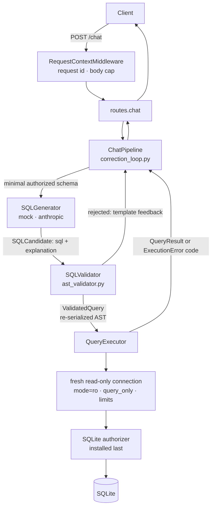

# Architecture: Phase 1

## Request flow



## Components and trust

| Layer | Module | Trusts | Enforces |
|---|---|---|---|
| Config | `app/config.py` | env vars at startup | frozen limits; `max_corrections ≤ 2` hard ceiling |
| Policy | `app/security/policies.py` | code only | immutable table/column/function allowlists |
| Introspection | `app/database/introspection.py` | fixed catalog queries | schema ∩ policy; minimal schema per question |
| Generator | `app/agent/*` | nothing | returns a *candidate* only; no handle on policy or limits |
| AST validator | `app/security/ast_validator.py`, `limits.py` | the policy | statement type, tables, columns (scope-aware), functions, stars, complexity, LIMIT/OFFSET |
| Capability type | `app/security/validated.py` | validator only | executor accepts nothing but `ValidatedQuery` |
| Authorizer | `app/database/authorizer.py` | the policy | engine-level READ/FUNCTION allowlist; deny everything else |
| Executor | `app/execution/query_executor.py` | `ValidatedQuery` | deadline, row cap, byte cap, safe error codes |
| API | `app/api/*`, `app/main.py` | nothing | strict schemas, body cap, no-leak error handlers |

## Key design decisions

1. **Validate one thing, execute the same thing.** The validator serializes the validated AST,
   re-parses and re-validates that exact string, and wraps it in `ValidatedQuery`. The original
   LLM string is never executed.
2. **Two independent enforcement layers.** The AST validator and the SQLite authorizer both
   consume the same `AccessPolicy` but share no code paths. Tests exercise the authorizer
   with raw, unvalidated SQL to prove it stands alone.
3. **Per-query connection.** Each query opens its own connection, installs its own authorizer
   and progress handler, and closes it. No mutable security state is shared across requests.
4. **Fail closed everywhere.** Unknown AST nodes, functions, unresolvable columns, scope-analysis
   gaps, authorizer exceptions, and unexpected validator errors all reject.
5. **Resource limits are separate from authorization.** Timeouts (progress handler), row caps
   (`fetchmany`), byte caps, and SQLite engine limits (`setlimit`) are enforced independently of
   whether a query is authorized.
6. **Provider-agnostic agent.** `SQLGenerator` is a protocol, so swapping the model never touches
   security code.

## Correction loop

```
attempt 1..3:
  candidate = generate(question, minimal_schema, feedback)   # GenerationError -> feedback, next
  result    = validate(candidate.sql)                          # rejected -> template feedback, next
  execute(result.query)
     ok                         -> return
     EXECUTION_FAILED           -> generic feedback, next
     TIMEOUT / AUTH_DENIED / DB -> stop immediately (no probing)
exhausted -> RETRY_BUDGET_EXHAUSTED
```
