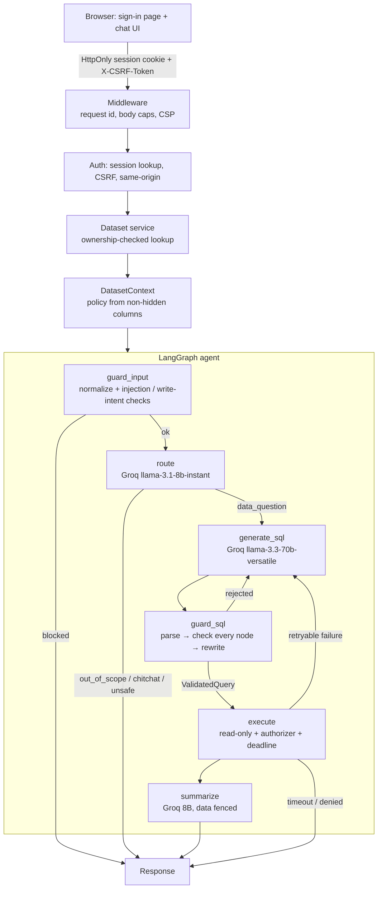

# Architecture

## End-to-end flow



## The SQL never reaches the database directly

1. The model returns JSON with an `sql` **candidate** string.
2. `guard_sql` parses it with SQLGlot into an AST and walks **every node**. It checks the
   statement type, tables, columns (scope-aware across joins, CTEs, sub-queries and aliases),
   functions, stars, joins, nesting, size and LIMIT/OFFSET literals.
3. The validated tree is normalized (`COUNT(*)` → `COUNT(1)`, a default `LIMIT` is added) and
   **serialized to fresh SQL**. That string is parsed and checked again.
4. Only a `ValidatedQuery` (a capability object only the guard can create) is accepted by the
   executor. A raw string is a type error.
5. The executor opens a new read-only connection, installs a **SQLite authorizer** built from
   the same dataset policy, sets a deadline, runs the query, and caps rows and bytes.

## Components

| Layer | Module | Responsibility |
|---|---|---|
| Config | `config.py`, `env.py` | frozen settings from `.env` / env vars; production guards |
| Auth | `auth/` | scrypt passwords, HMAC-hashed session tokens, CSRF, rate limits |
| Storage | `storage/app_db.py` | users, sessions, datasets, query log (fixed, parameterised SQL) |
| Ingestion | `storage/datasets.py` | CSV → SQLite, safe identifiers, types, dates, indexes, stats, sensitive-column hiding |
| Policy | `security/policies.py` | per-dataset allowlist from non-hidden tables/columns |
| Prompt guard | `security/prompt_guard.py` | input normalization, injection/write-intent detection, fencing |
| AST guard | `security/ast_validator.py`, `limits.py` | parse → check → rewrite → re-check |
| Authorizer | `database/authorizer.py` | engine-level READ/FUNCTION allowlist, deny everything else |
| Executor | `execution/query_executor.py` | deadline, row/byte caps, query plan, safe error codes |
| LLM | `agent/llm.py` | Groq JSON-mode client with retries; mock and scripted clients |
| Agent | `agent/graph.py`, `prompts.py` | LangGraph state machine, bounded corrections, summaries |
| API | `api/` | REST endpoints, dependencies, schemas |
| Web | `web/static/` | vanilla JS SPA, textContent-only rendering, strict CSP |

## Groq model choice (free tier)

| Purpose | Default model | Why |
|---|---|---|
| Draft SQL | `llama-3.3-70b-versatile` | strongest free model for structured SQL |
| Route + summarize | `llama-3.1-8b-instant` | fast, with a much higher daily request quota |

Both are configurable in `.env`. Every call uses JSON mode and temperature 0.

## Data model (app database)

```
users(id, email UNIQUE, name, password_hash, created_at)
sessions(token_hash PK, user_id, csrf_token, created_at, expires_at)
datasets(id, user_id, name, db_file, meta_json, created_at)
query_log(request_id, user_id, dataset_id, conversation_id, question, sql, status, codes, created_at)
```

Each dataset is its own SQLite file under `data/users/<user_id>/<dataset_id>.db`, so users are
isolated at the file level as well as through ownership-checked lookups.

## Follow-up questions

Each chat carries a `conversation_id`. The last N successful (question, validated SQL) pairs are
fetched from `query_log` and given to the model as fenced `<history>`, so "what about 2024?" works.
